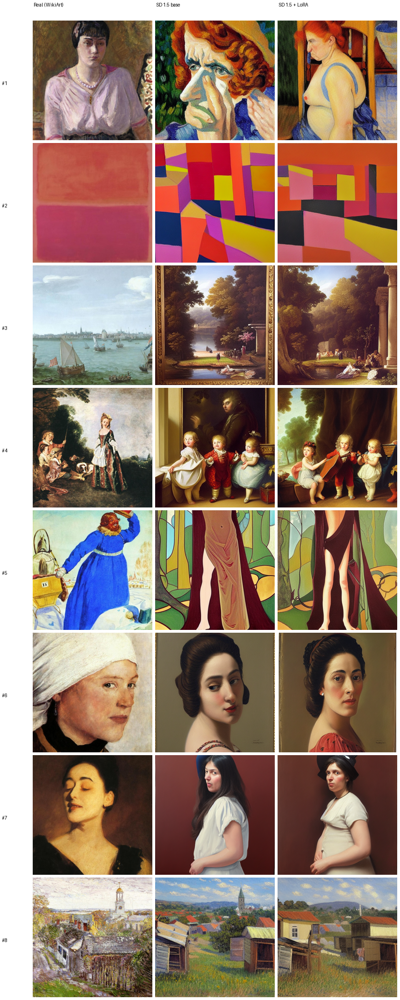
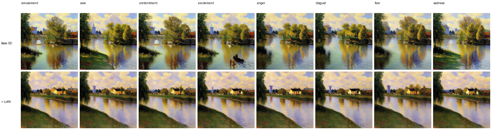

# Tạo ảnh nghệ thuật từ văn bản: fine-tune Stable Diffusion 1.5 bằng LoRA trên ArtEmis

Đồ án môn **Nhập môn Trí tuệ nhân tạo** · Giảng viên: **Đoàn Thiện Minh**

| Sinh viên | MSSV | Lớp |
|---|---|---|
| Nguyễn Thị Bình An | 123001264 | 23CT111 |
| Tống Anh Kha | 123000367 | 23CT111 |
| Hồ Cẩm Tú | 123000269 | 23CT111 |

Dùng **Stable Diffusion 1.5** làm mô hình nền, huấn luyện thêm **LoRA** trên bộ **ArtEmis** (chú thích cảm xúc) gắn
với tranh **WikiArt**, dùng **CLIP** để đánh giá. Giao diện web Gradio nhận mô tả **tiếng Việt hoặc tiếng Anh**.

Prompt khi huấn luyện và khi sinh ảnh có cùng định dạng:
`a painting in the {phong cách} style that evokes {cảm xúc}, {mô tả}`



## Chạy demo nhanh (không cần train, không cần dữ liệu)

Repo đã kèm trọng số LoRA đã train (`outputs/lora/final`, khoảng 12MB).

```powershell
git clone https://github.com/anhkha7/Sinh_Anh.git
cd Sinh_Anh
python -m venv .venv
.venv\Scripts\activate
pip install torch torchvision --index-url https://download.pytorch.org/whl/cu124   # máy có card NVIDIA
pip install -r requirements.txt
python app.py --lora_dir outputs/lora/final
```

Mở địa chỉ hiện ra (thường `http://127.0.0.1:7860`). Lần chạy đầu cần Internet để tải Stable Diffusion 1.5
(vài GB), CLIP (khoảng 600MB) và mô hình dịch Việt-Anh (khoảng 300MB).

Không có card NVIDIA? Dùng Google Colab: mở `colab_demo.ipynb`, chọn GPU T4 và chạy lần lượt các cell.
Muốn ép chạy bằng CPU (ví dụ card bị lỗi ảnh đen): thêm `--device cpu`.

## Hướng dẫn chạy trên laptop (GTX 1650, dùng khi báo cáo)

Laptop GTX 1650 chỉ có 4GB VRAM và dòng GTX 16xx có lỗi đã biết với Stable Diffusion fp16 (ảnh đen/xanh). Nhóm **chưa
kiểm chứng trên card này**, nên có hai cách, ưu tiên cách A.

**Cách A (khuyên dùng): chạy trên Google Colab, laptop chỉ cần trình duyệt.**
1. Mở `colab_demo.ipynb` trên Colab, chọn **Runtime > Change runtime type > T4 GPU**.
2. Chạy lần lượt các cell; cell cuối in ra đường link `https://....gradio.live`, mở link đó để dùng giao diện.
3. Bắt đầu chạy trước giờ báo cáo ít nhất 15 phút (lần đầu tải vài GB mô hình) và giữ tab Colab mở.

**Cách B: chạy trực tiếp trên laptop** (cần cài sẵn Python 3.10-3.13 và Git; cần Internet và khoảng 10GB trống ở lần đầu):
```powershell
git clone https://github.com/anhkha7/Sinh_Anh.git
cd Sinh_Anh
python -m venv .venv
.venv\Scripts\activate
pip install torch torchvision --index-url https://download.pytorch.org/whl/cu124
pip install -r requirements.txt
python app.py --lora_dir outputs/lora/final
```
- Nếu `pip install torch` báo lỗi hoặc `torch.cuda.is_available()` là `False`: cập nhật driver NVIDIA, hoặc cài bản CPU
  (`--index-url https://download.pytorch.org/whl/cpu`).
- Nếu ảnh sinh ra bị **đen hoặc xanh**: chạy `python app.py --lora_dir outputs/lora/final --device cpu` (rất chậm, ước tính vài
  phút mỗi ảnh; bản thử 1 ảnh 6 bước trên máy nhóm mất khoảng 2 phút kể cả tải mô hình).
- Trong giao diện hạ **Số ảnh = 1** và **Số bước = 15-20** để nhanh hơn và đỡ tràn VRAM.

**Chuẩn bị trước ngày báo cáo:** chạy thử toàn bộ một lần (để mô hình đã được tải sẵn vào máy khi còn Internet) và chuẩn bị
sẵn video quay màn hình demo cùng một thư mục ảnh đã sinh làm phương án dự phòng.

## Yêu cầu phần cứng

| Việc | Cần gì |
|---|---|
| Chạy demo | Card NVIDIA VRAM khoảng 6GB trở lên (ước tính theo kinh nghiệm chung; đã chạy tốt trên RTX 3060 12GB) |
| Chạy demo không có GPU | Được, tự chuyển sang CPU nhưng rất chậm (ước tính vài phút mỗi ảnh); hạ "Số ảnh" xuống 1 và số bước xuống 15-20 |
| Huấn luyện | Card NVIDIA khoảng 10-12GB VRAM, hoặc Google Colab T4 |

Lưu ý: dòng **GTX 16xx** (ví dụ GTX 1650) có lỗi đã biết với Stable Diffusion ở chế độ fp16, ảnh sinh ra có thể bị đen
hoặc xanh, và 4GB VRAM rất sát giới hạn. Chưa được kiểm chứng trên card đó; nên dùng Colab hoặc card mạnh hơn.

## Cấu trúc

| File | Vai trò |
|---|---|
| `prepare_data.py` | Ghép CSV với ảnh WikiArt, chọn tập con (cân bằng theo cảm xúc), resize 512, tách train/val |
| `dataset.py` | Dataset: mỗi lần lấy 1 tranh + 1 chú thích (ngẫu nhiên nếu tranh có nhiều chú thích) |
| `train_lora.py` | Huấn luyện LoRA, lưu checkpoint, `--resume`, sinh ảnh mẫu theo dõi |
| `inference.py` | Sinh ảnh (SD gốc hoặc SD + LoRA) |
| `clip_scorer.py` | Chấm điểm và embedding CLIP |
| `evaluate.py` | CLIP score, SD gốc so với SD + LoRA, lưới ảnh so sánh (`compare_grid.png`, `emotion_grid.png`) |
| `evaluate_extra.py` | Độ giống tranh thật cùng phong cách và khả năng điều khiển cảm xúc (có khoảng tin cậy) |
| `translator.py` | Dịch mô tả tiếng Việt sang tiếng Anh (Helsinki-NLP/opus-mt-vi-en, chạy cục bộ trên CPU) |
| `app.py` | Web UI Gradio, nhập được tiếng Việt (tự dịch) hoặc tiếng Anh |
| `colab_demo.ipynb` | Chạy demo trên Google Colab từ repo GitHub (không cần train) |
| `colab_train.ipynb` | Chạy toàn bộ quy trình train trên Google Colab |

## Dữ liệu (không có trong repo)

Dữ liệu có bản quyền và điều khoản riêng nên không được đưa lên repo. Cần tự tải:

- **Chú thích ArtEmis** từ trang dự án ArtEmis (artemisdataset.org). Code cần một file CSV có các cột `emotion`,
  `utterance`, `art_style`, `painting`. Đồ án này dùng file `dataset_final.csv` (1 chú thích cho mỗi tranh).
- **Ảnh WikiArt** (khoảng 25-30GB), ví dụ Kaggle `steubk/wikiart`. Tên file ảnh phải trùng cột `painting`.

## Huấn luyện lại (tùy chọn)

Cài môi trường như phần demo, đặt CSV và ảnh WikiArt (ví dụ `E:\wikiart`), rồi:

1. Chuẩn bị dữ liệu (có thể chạy lại, ảnh đã xử lý được bỏ qua):
   ```powershell
   python prepare_data.py --csv dataset_final.csv --images-root E:\wikiart --out data --num-paintings 8000
   ```
   Mặc định cân bằng theo cảm xúc (`--balance emotion`); dùng `--balance style` để cân bằng theo phong cách.
2. Huấn luyện (chạy lại cùng lệnh với `--resume` nếu bị gián đoạn, mất khoảng 3 giờ trên RTX 3060):
   ```powershell
   python train_lora.py --data_dir data --output_dir outputs/lora --max_steps 6000 --resume
   ```
   Chạy thử nhanh trước: thêm `--limit 200 --max_steps 50 --save_every 25 --sample_every 50`.
3. Đánh giá (mỗi lệnh khoảng 10-20 phút):
   ```powershell
   python evaluate.py --data_dir data --lora_dir outputs/lora/final
   python evaluate_extra.py --data_dir data --lora_dir outputs/lora/final
   ```

Mỗi lần mở terminal mới phải chạy lại `.venv\Scripts\activate` (thấy `(.venv)` ở đầu dòng là đúng).

Trên Colab: copy mã nguồn và file CSV lên `MyDrive/artemis_sd/`, mở `colab_train.ipynb`, chọn GPU T4 và chạy lần lượt các cell.
Checkpoint lưu trên Drive nên có thể chạy lại sau khi bị ngắt phiên. Lưu ý: notebook đang tải ảnh bằng `kaggle.json`
(token kiểu cũ); với token mới (`KGAT_...`) cần đặt biến môi trường `KAGGLE_API_TOKEN` thay vào đó, và đổi biến `CSV`
trong notebook cho đúng tên file CSV của bạn.

## Cấu hình đã dùng

- 8000 tranh (7600 train / 400 val), 1 chú thích/tranh, cân bằng theo cảm xúc (mỗi cảm xúc khoảng 830-975 tranh train).
- LoRA rank 16 trên attention của UNet, VAE và text encoder đóng băng, fp16, batch 1 x grad_accum 4,
  learning rate 1e-4 (cosine), 6000 bước cập nhật, độ phân giải 512.

## Kết quả đánh giá (100 prompt của tập val, 1 seed/prompt)

**Độ giống tranh thật cùng phong cách** (CLIP cosine với tâm các tranh WikiArt thật cùng phong cách, `evaluate_extra.py`):

| | giống phong cách đúng | độ đặc trưng phong cách |
|---|---|---|
| Ảnh thật (tham chiếu) | 0.819 | 0.101 |
| SD gốc | 0.784 | 0.088 |
| SD + LoRA | 0.802 | 0.097 |

LoRA hơn SD gốc +0.019 (khoảng tin cậy 95%: +0.011 đến +0.026) và thắng 72/100 prompt; độ đặc trưng +0.009
(+0.004 đến +0.015). Đây là cải thiện có ý nghĩa thống kê.

**Điều khiển cảm xúc: chưa chứng minh được.** Thí nghiệm 96 ảnh/mô hình (6 nội dung trung tính x 8 cảm xúc x 2 seed),
đo bằng bộ phân loại cảm xúc huấn luyện trên tranh thật (chính bộ phân loại này chỉ đạt 26% trên ảnh thật của tập val,
ngẫu nhiên là 12.5%):

| | đúng cảm xúc | lift | độ nhạy |
|---|---|---|---|
| SD gốc | 12.5% | +0.005 | 0.092 |
| SD + LoRA | 14.6% | +0.008 | 0.075 |

Chênh lệch giữa LoRA và gốc không có ý nghĩa thống kê (lift +0.004, khoảng -0.002 đến +0.010), và `emotion_grid.png`
cho thấy ảnh gần như không đổi khi đổi từ khóa cảm xúc. Kết luận: mô hình **học được phong cách, chưa học được điều khiển cảm xúc**.



**CLIP score (độ khớp ảnh với câu chú thích, `evaluate.py`):** ảnh thật 28.7, SD gốc 31.6, SD + LoRA 31.1
(LoRA thấp hơn 0.5 điểm, khoảng -0.89 đến -0.11, thắng 41/100). Thước đo này không phản ánh mục tiêu của đồ án,
vì chú thích ArtEmis mang tính chủ quan nên chính ảnh thật cũng được điểm thấp hơn ảnh sinh ra.

## Hạn chế

- Không train sinh ảnh từ đầu (cần hàng trăm GPU-ngày); đồ án fine-tune mô hình đã có bằng LoRA (khoảng 3 triệu tham số).
- Câu chú thích ArtEmis mang tính chủ quan và cảm xúc ("màu sắc làm tôi thấy bình yên"), ít mô tả nội dung, nên mô hình
  không đảm bảo vẽ đúng nội dung cụ thể trong mô tả.
- Nhãn cảm xúc nhiễu: cả bộ phân loại huấn luyện trên tranh thật cũng chỉ đoán đúng 26%. Điều khiển cảm xúc yếu không
  phải do dữ liệu lệch (dữ liệu train đã cân bằng theo cảm xúc).
- Mỗi tranh chỉ có 1 chú thích, và các thước đo chỉ chạy với 1 seed/prompt.
- Mô hình chỉ hiểu tiếng Anh; mô tả tiếng Việt được dịch tự động bằng mô hình nhỏ nên có thể mất từ ở câu phức tạp
  (bản dịch hiện trong ô "Thông tin" để kiểm tra).
- Bộ lọc an toàn (safety checker) của SD mặc định tắt vì hay chặn nhầm tranh cổ điển, nên ảnh sinh ra có thể chứa
  nhân vật khỏa thân như trong nhiều tranh WikiArt; bật lại bằng `safety_checker=True` trong `ArtGenerator`.

## Giấy phép và trích dẫn

Dự án phục vụ học tập. Trọng số LoRA là mô hình phái sinh của Stable Diffusion 1.5 (giấy phép CreativeML OpenRAIL-M).
Dữ liệu ArtEmis và ảnh WikiArt thuộc về chủ sở hữu của chúng; hãy đọc và tuân thủ điều khoản sử dụng của từng bộ dữ liệu
trước khi dùng cho mục đích khác.

- Achlioptas, Ovsjanikov, Haydarov, Elhoseiny, Guibas. *ArtEmis: Affective Language for Visual Art.* CVPR 2021.
- Rombach et al. *High-Resolution Image Synthesis with Latent Diffusion Models.* CVPR 2022 (Stable Diffusion).
- Hu et al. *LoRA: Low-Rank Adaptation of Large Language Models.* ICLR 2022.
- Radford et al. *Learning Transferable Visual Models From Natural Language Supervision.* ICML 2021 (CLIP).
